<div align="center">


<a href="https://github.com/chiranji-xt">
  
</a>

<br/>


</div>

## `> whoami`

I work on **machine learning and data science**, and I like building the tools that check whether a model, an agent or a system can actually be trusted: **how it fails, why it failed, and what it leaks.** Every project below ships with automated tests and a README that says plainly what is verified and what is not.

<table>
  <tr><td>🎯 <b>Focus</b></td><td>Machine Learning · Data Science · model evaluation</td></tr>
  <tr><td>🛠️ <b>I build</b></td><td>Robustness testing for detectors · replayable AI-agent runs · on-device leak prevention · ML-assisted intrusion detection</td></tr>
  <tr><td>🐍 <b>Languages</b></td><td>Python · C++ · JavaScript</td></tr>
  <tr><td>🧪 <b>Habit</b></td><td>Tests first · seeded, reproducible experiments · held-out confirmation · honest status notes</td></tr>
</table>

<div align="center"></div>

## `> where my projects fit`

<div align="center">
</div>

<div align="center"></div>

## `> ls projects/`

### 01 · FailureForge: find exactly how a YOLO detector breaks

<a href="https://github.com/chiranji-xt/FailureForge"></a>

<div align="center">
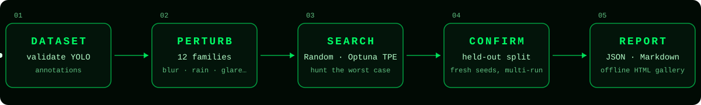
</div>

- **Hunts for the worst case.** Random Search or Optuna TPE explores perturbation settings across 12 families (blur, lighting, weather, lens effects, occlusion, rotation and more) to find the ones that hurt the detector most.
- **Refuses to fool itself.** Search scores are tuned on a discovery split, then *confirmed on a disjoint holdout with fresh seeds*, so a lucky setting doesn't pass as a real weakness.
- **Keeps measurements honest.** Verified failures and label-free "prediction instability" are reported separately, and instability is never presented as accuracy. Invalid trials are listed but never scored as zero.
- **Audited, not assumed.** The matcher and AP code agreed with an independently written reference on 40 random scenes (mAP to 1e-12). Three slow perturbations (`rain`, `lens_flare`, `motion_blur`) were optimised with output verified bit-identical to the originals (`rain` had been a per-pixel Python loop costing ~104 ms per 640×640 image).

<details>
<summary><b>Usage and design notes</b></summary>

<br/>

```python
from failureforge.dataset import YoloDataset
from failureforge.search import SearchSpace, run_random_search, confirm_trials, write_search_report

ds = YoloDataset.from_config("data.yaml")
discovery, holdout = ds.partition(0.3, seed=123)           # discovery vs held-out split
space = SearchSpace.default(include=["gaussian_blur", "darken", "rotation"])
result = run_random_search(det, discovery, budget=20, seed=0, space=space)
confirmation = confirm_trials(det, holdout, result.trials, top_k=3, n_seeds=3)
write_search_report(result, "results", confirmation)       # JSON / Markdown / CSV + offline HTML gallery
```

```bash
failureforge validate-data --data data.yaml
failureforge search  --data data.yaml --weights best.pt --method random --budget 30 --metric f1 --gallery
failureforge compare --data data.yaml --weights best.pt --runs 5 --budget 30   # random vs TPE, equal budget
```

**Status:** covered by 600+ automated tests that run on CPU with no weights or network, using a rule-based stand-in detector. Runs against real YOLO weights are the next milestone, and the README says so.

</details>

<br/>

### 02 · flightrec: replay a failed agent run, offline

<a href="https://github.com/chiranji-xt/flightrec"></a>

- **The problem.** An agent run that failed never happens the same way twice: the model answers differently and the search returns new results.
- **The idea.** Record every model call, tool call, clock read and dice roll to a plain JSON Lines file, then replay it as often as you like with no network and no cost.
- **It fails loudly.** If your code changes what it does during replay, flightrec raises `ReplayDivergence` and names the step instead of quietly drifting.
- **It works with the real SDK.** Replayed responses are rebuilt as the Anthropic SDK's own types, including async clients and streams. No runtime dependencies.

<details>
<summary><b>Record, replay and branch</b></summary>

<br/>

```python
import flightrec

# Record: calls run for real and are written to the file as they happen.
with flightrec.Recorder("runs/bad.jsonl") as rec:
    run_agent(rec.wrap(anthropic.Anthropic()), task)

# Replay: nothing runs. Results come from the file, in order.
with flightrec.Recorder("runs/bad.jsonl", mode="replay") as rec:
    run_agent(rec.wrap(None), task)

# Branch: change what step 31 returned and continue live from there.
with flightrec.Recorder("runs/bad.jsonl", mode="branch", at=31,
                        response={"results": [{"title": "the right page"}]},
                        out="runs/bad.branch.jsonl") as rec:
    run_agent(rec.wrap(anthropic.Anthropic()), task)
```

```text
$ flightrec diff runs/demo.jsonl runs/demo-bad.jsonl
first divergence at step 1: same request, different result
```

A single self-contained browser viewer (`flightrec view`) lets you scrub the timeline, and a committed recording doubles as a CI regression test that cannot flake. Status: alpha (v0.1), with CI.

</details>

<br/>

### 03 · pasteguard: keep secrets out of AI chats

<a href="https://github.com/chiranji-xt/pasteguard"></a>

- **Catches what matters.** 102 API-key formats across providers, private keys, tokens, passwords in URLs and commands, cards (issuer, length and Luhn checksum), IBANs (mod-97) and national IDs (Aadhaar via Verhoeff checksum, PAN, US SSN).
- **Stays quiet on purpose.** Placeholders, documentation examples, test card numbers and code that merely *refers* to a secret are ignored, backed by a corpus of innocent text that must stay silent.
- **Private by construction.** Everything is checked on your device. The extension has no code that can send data anywhere, and the tests enforce that.
- **Verified, and honest about it.** 355 automated tests pass. The README separates what is verified (detection engine, content script, a hand-checked run on ChatGPT) from what is not yet (other sites, Firefox).

<details>
<summary><b>What it does to a paste</b></summary>

<br/>

```text
OPENAI_API_KEY=[REDACTED:OPENAI_API_KEY]
DATABASE_URL=postgres://app:[REDACTED:URL_CREDENTIALS]@db.internal:5432/app
GITHUB_TOKEN=[REDACTED:GITHUB_TOKEN]
```

"Redact and paste" swaps each secret for a label, so you can still ask your question and the AI still knows what was there. A typing banner offers a one-click redact if a secret appears in the message box, without ever interrupting your typing. Three sensitivity levels, per-category switches and a per-value "this is fine" button keep it usable.

</details>

<br/>

### 04 · Arborflow: a C++ firewall from advanced data structures

<a href="https://github.com/chiranji-xt/Arborflow"></a>

| Structure | Where | Complexity | Purpose |
|---|---|---|---|
| BitVector | Layer 1 filter | O(1) | Fast /16 prefix blacklist in 8 KB |
| RS-vEB tree | Layer 2 filter | O(1) amortised | Exact 32-bit IP blacklist |
| Lock-free SPSC queue | Thread boundary | O(1) | Zero-contention packet hand-off |
| Max-heap | Scheduler | O(log n) | Priority-based packet ordering |
| Splay tree | Session tracker | O(log n) amortised | Active-connection cache |

- **Two ways to run.** Live libpcap capture with a blacklist file, or an IPC mode where a Python ML backend (XGBoost + Isolation Forest) controls the C++ engine and blocks attacks dynamically.
- **Honest roadmap.** Fibonacci-heap QoS, eBPF/XDP offload and benchmarking on real pcap traces are listed as still to do.

<br/>

### 05 · TRASH_WORK: from a citizen's photo to a live map of waste

<a href="https://github.com/chiranji-xt/TRASH_WORK"></a>

```text
 Flutter app  ───▶  FastAPI backend  ───▶  PostgreSQL + PostGIS
 (mobile)           (Python)                      │
                        │                         ▼
                        ▼                   React dashboard
                 YOLOv8 inference          (hotspots, status)
```

- **Full stack, five modules:** `machine-learning`, `backend-database`, `demo-backend`, `mobile-app` and `web-dashboard`, brought up together with Docker Compose.
- **A real API:** upload a photo with its geolocation, list reports, query reports in an area, filter by `pending` or `cleaned`, and pull aggregated stats and **garbage hotspots**. Status changes need an admin key.

<br/>

### 06 · LOCUS-X: reliable positioning when signals are noisy or blocked

<a href="https://github.com/chiranji-xt/locus-x"></a>

A **team project** (built by team Epoch_12 at VIT Pune for CODE APEX 3.0) that I forked: a fictional three-floor hospital digital twin plus a reproducible indoor-positioning lab. A simulator produces noisy ranges with NLOS bias and packet loss, and three methods (a baseline, statistical LOCUS-X, and LOCUS-X with a trained LOS/NLOS reliability model) are compared on identical observations.

- **Rigorous evaluation.** A frozen final test on reserved seeds, with a committed `+0.5%` regression guard.
- **A result worth respecting.** The team's v2 AI model improved classification but did *not* beat the statistical method overall, so the guard rejected it and the runtime kept v1. No post-test tuning was done.

<br/>

### 07 · Square Inch: an image-first studio portfolio

<a href="https://square-interior-2.vercel.app/"></a>

A live production site for an interior design studio in Pune and Satara: Lenis smooth scroll, GSAP scroll-triggered motion, Framer Motion masks and pinned stories, a swipeable lightbox, per-route SEO shells with a generated sitemap, and content that can be edited without touching code. Respects `prefers-reduced-motion`.

<details>
<summary><b>More team and hackathon work</b></summary>

<br/>

| Repo | What it is |
|---|---|
| [Smart-Garbage-Detection](https://github.com/chiranji-xt/Smart-Garbage-Detection) | Hackathon prototype (team project, fork): AI garbage detection with geospatial mapping, a backend API, a mobile app and a web dashboard |
| [IoT incident response](https://github.com/chiranji-xt/Cloud-Based-Incident-Response-System-for-IoT-Enviornments) | Team project (fork): real-time IoT monitoring, threat detection and automated response with a cloud dashboard |

</details>

<div align="center"></div>

## `> cat skills.json`

<div align="center">
</div>

<div align="center"></div>

## `> model.summary()`

<div align="center">
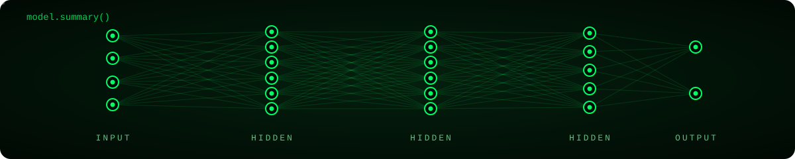
</div>

```python
class MLEngineer:
    focus   = ["Machine Learning", "Data Science"]
    builds  = ["robustness tests", "replayable agents", "leak guards", "intrusion detection"]
    toolkit = ["Python", "NumPy", "scikit-learn", "XGBoost", "YOLO", "Optuna"]

    def principle(self):
        return "If it can't be measured, it can't be trusted."
```

<div align="center"></div>

## `> git log --how-i-work`

<div align="center">
</div>

<div align="center"></div>

## `> snake --eat contributions`

<div align="center">

</div>

<div align="center"></div>

## `> git stats`

<div align="center">


<br/><br/>


</div>
