<div align="center">



<a href="https://github.com/chiranji-xt">
  
</a>

<br/>


</div>

## `> whoami`

I work on **machine learning and data science**, with a habit of building the tools that check whether a model, an agent or a system can actually be trusted: how it fails, why it failed, and what it leaks.

<table>
  <tr><td>🎯 <b>Focus</b></td><td>Machine Learning · Data Science · model evaluation</td></tr>
  <tr><td>🛠️ <b>I build</b></td><td>Robustness testing for detectors · replayable AI-agent runs · on-device leak prevention · ML-assisted intrusion detection</td></tr>
  <tr><td>🔭 <b>Exploring</b></td><td>Robust ML positioning under noisy, sparse and NLOS signals (<a href="https://github.com/chiranji-xt/locus-x">locus-x</a>)</td></tr>
  <tr><td>🐍 <b>Languages</b></td><td>Python · C++ · JavaScript</td></tr>
  <tr><td>🧪 <b>Habit</b></td><td>Tests first, measured results, honest status notes in every README</td></tr>
</table>

<div align="center"></div>

## `> model.summary()`

<div align="center">

</div>

```python
class MLEngineer:
    focus   = ["Machine Learning", "Data Science"]
    builds  = ["robustness tests", "replayable agents", "leak guards", "intrusion detection"]
    toolkit = ["Python", "NumPy", "Pandas", "scikit-learn", "XGBoost", "YOLO", "Optuna"]

    def principle(self):
        return "If it can't be measured, it can't be trusted."
```

<div align="center"></div>

## `> cat stack.txt`

<div align="center">


<br/>


</div>

## `> ls projects/`

<div align="center">
<table>
  <tr>
    <td><a href="https://github.com/chiranji-xt/FailureForge"></a></td>
    <td><a href="https://github.com/chiranji-xt/Arborflow"></a></td>
  </tr>
  <tr>
    <td><a href="https://github.com/chiranji-xt/locus-x"></a></td>
    <td><a href="https://github.com/chiranji-xt/TRASH_WORK"></a></td>
  </tr>
  <tr>
    <td><a href="https://github.com/chiranji-xt/flightrec"></a></td>
    <td><a href="https://github.com/chiranji-xt/pasteguard"></a></td>
  </tr>
  <tr>
    <td><a href="https://square-interior-2.vercel.app/"></a></td>
    <td><a href="https://github.com/chiranji-xt/Cloud-Based-Incident-Response-System-for-IoT-Enviornments"></a></td>
  </tr>
</table>

<sub>Cards marked FORK are team projects or upstream work I forked and built on.</sub>


</div>

## `> spotlight: FailureForge`

**How does a YOLO detector fail, and can you prove it?** [FailureForge](https://github.com/chiranji-xt/FailureForge) answers that with a repeatable pipeline instead of a few cherry-picked screenshots.

<div align="center">

</div>

- **Hunts for the worst case.** Random Search or Optuna TPE explores perturbation settings (blur, rain, glare, darkening, rotation and more) to find the ones that hurt the detector most.
- **Refuses to fool itself.** Search scores are tuned on one split and *confirmed on a disjoint holdout with fresh seeds*, so a lucky setting doesn't pass as a real weakness.
- **Keeps measurements honest.** Verified failures and label-free "prediction instability" are reported separately, and instability is never presented as accuracy.
- **Audited, not assumed.** The matcher and AP code was checked against an independently written reference on 40 random scenes, and three slow perturbations were sped up with bit-identical output. Over 600 automated tests back it.
- **Plain about its limits.** It runs today against a rule-based stand-in detector in tests, and says so; runs on real YOLO weights are the next milestone.

<div align="center"></div>

## `> under the hood`

<details>
<summary><b>flightrec</b>: replay a failed AI-agent run offline, then branch from any step</summary>

<br/>

An agent run that failed will never happen the same way twice: the model answers differently, the search returns new results. [flightrec](https://github.com/chiranji-xt/flightrec) turns one bad run into a file you can replay as many times as you like, with no API calls.

```python
import flightrec

# Record: calls run for real and are written to a JSON Lines file.
with flightrec.Recorder("runs/bad.jsonl") as rec:
    run_agent(rec.wrap(anthropic.Anthropic()), task)

# Replay offline: no network, no cost. If your code changes what it does,
# replay raises ReplayDivergence and names the step instead of quietly drifting.
with flightrec.Recorder("runs/bad.jsonl", mode="replay") as rec:
    run_agent(rec.wrap(None), task)
```

Branch from any step, scrub the run in a browser viewer, or `flightrec diff` two runs to find the first step where they split. No dependencies, and commit a recording as a CI regression test that cannot flake.

</details>

<details>
<summary><b>pasteguard</b>: stop secrets from being pasted into AI chats</summary>

<br/>

[pasteguard](https://github.com/chiranji-xt/pasteguard) checks what you paste, drop or attach on ChatGPT, Claude, Gemini and other AI chat sites. If it finds an API key, password, private key or personal ID, it holds the paste back and lets you **redact**, paste anyway, or cancel.

```text
OPENAI_API_KEY=[REDACTED:OPENAI_API_KEY]
DATABASE_URL=postgres://app:[REDACTED:URL_CREDENTIALS]@db.internal:5432/app
GITHUB_TOKEN=[REDACTED:GITHUB_TOKEN]
```

Everything is checked on your device, and the tests enforce that the extension has no code path that sends data anywhere. The detection engine is covered by 350+ automated tests, including a corpus of innocent text that must stay silent.

</details>

<details>
<summary><b>Arborflow</b>: a C++ firewall built from advanced data structures, with an ML backend</summary>

<br/>

[Arborflow](https://github.com/chiranji-xt/Arborflow) captures live traffic with libpcap, filters packets through a two-layer IP blacklist (a BitVector prefix filter plus a vEB tree for exact match), tracks sessions with a splay tree and schedules packets by priority with a max-heap. An optional Python backend (XGBoost + Isolation Forest) talks to the C++ engine over IPC to detect and block attacks dynamically.

</details>

<details>
<summary><b>TRASH_WORK</b>: from a citizen's photo to a map of waste</summary>

<br/>

[TRASH_WORK](https://github.com/chiranji-xt/TRASH_WORK) is a Smart Garbage Detection and Community Mapping platform: YOLOv8 detects garbage in citizen-submitted photos, geotagged reports are stored in PostGIS, and a Flutter mobile app and React dashboard visualise them for municipal clean-up teams. Docker Compose brings the stack up.

</details>

<div align="center"></div>

## `> git stats`

<div align="center">


<br/><br/>


</div>
